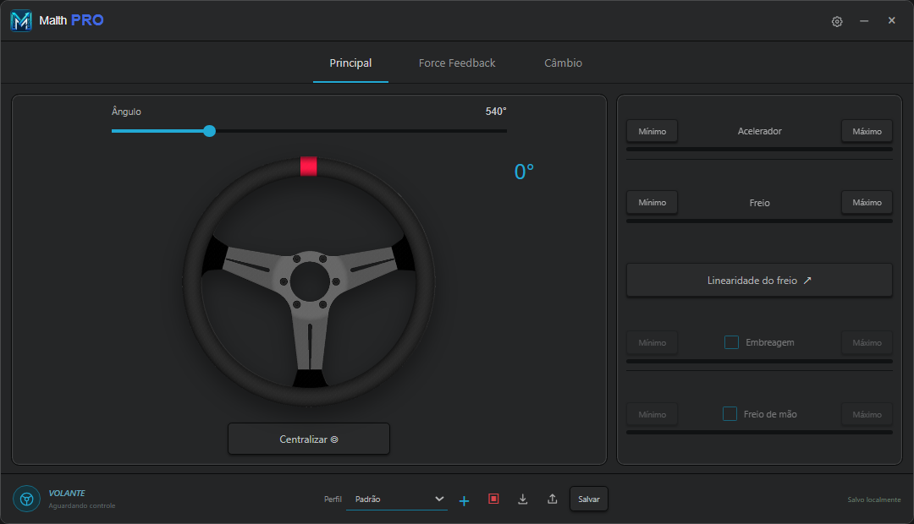

# Malth Pro

Aplicativo para Windows e firmware para Arduino Leonardo, desenvolvidos para
configurar um volante com Force Feedback, pedais e câmbio.

Projeto pessoal, mantido neste repositório privado para backup e controle de versões.



*Tela principal da versão 1.2.3, capturada sem conexão com o Arduino.*

## Recursos

- Leitura do volante pelo encoder e ajuste de ângulo de 30° a 2160°.
- Calibração de mínimo e máximo dos quatro pedais.
- Linearidade do freio em dez pontos.
- Câmbio H-Shifter ou sequencial, com visualização ao vivo.
- Configuração dos efeitos de Force Feedback e mola para jogos sem FFB.
- Perfis de configuração e gravação dos ajustes no Arduino.

## Hardware utilizado

- **Arduino Leonardo:** ATmega32U4, 16 MHz / 5 V.
- **Ponte H BTS7960**, com um motor DC.
- Encoder incremental, pedais analógicos e potenciômetros X/Y para o câmbio.
- Matriz de botões 4×4 prevista no firmware, com uso opcional.

### Pinagem principal

| Componente | Pinos do Leonardo |
| --- | --- |
| Encoder A / B | D0 / D1 |
| Acelerador / freio | A0 / A1 |
| Embreagem / freio de mão | A2 / A3 |
| Câmbio X / Y | A4 / A5 |
| BTS7960 R_EN + L_EN, juntos | D8 |
| BTS7960 LPWM / RPWM | D9 / D10 |

O índice Z não está ligado nesta montagem. O modo permanece **2 PWM + 1 DIR**
na interface; nesta ligação, D8 é a habilitação comum da BTS7960.

## Instalar o aplicativo

1. Feche uma versão anterior do Malth Pro, se estiver aberta.
2. Execute o instalador do Windows e siga as etapas da instalação.
3. Abra **Malth Pro** pelo atalho criado.

Os instaladores de desenvolvimento usam um certificado local de teste.
A confiança desse certificado vale para o PC onde ele foi configurado.
Instruções para gerar o instalador: [desktop/README.md](desktop/README.md).

## Gravar o `.hex` no Arduino

O aplicativo é instalado no Windows. O arquivo `.hex` contém o firmware que
deve ser gravado no **Arduino Leonardo**.

**Faça a gravação com a alimentação de potência do motor desligada**, mantendo
somente o USB conectado. Feche o Malth Pro e qualquer Monitor Serial antes de começar.

### 1. Preparar as ferramentas e gerar o firmware

Abra o PowerShell na pasta principal do projeto e execute:

```powershell
.\firmware\build-firmware.ps1
```

Na primeira execução, o script precisa de internet para baixar o Arduino CLI e
as ferramentas de compilação. O arquivo gerado será:

```text
firmware/releases/MalthPro-Leonardo-v0.1.0.hex
```

### 2. Identificar a porta do Leonardo

No **Gerenciador de Dispositivos do Windows → Portas (COM e LPT)**, confira a
porta do Arduino, por exemplo `COM5`.

### 3. Enviar o firmware

Substitua `COM5` pela porta identificada:

```powershell
.\firmware\upload-leonardo.ps1 -Port COM5
```

O script solicita a entrada no bootloader Caterina e faz a gravação pelo USB.
A porta pode mudar temporariamente durante esse processo.

Se utilizar outro gravador, selecione **Arduino Leonardo** e o arquivo
`MalthPro-Leonardo-v0.1.0.hex`. **Não use o arquivo `with_bootloader` para gravação USB.**

Se a gravação falhar, confira a porta COM e se algum programa ainda está usando
o Arduino. Mais detalhes: [firmware/README.md](firmware/README.md).

## Configurar o Malth Pro

### Conexão e volante

1. Deixe o volante reto antes de conectar ou abrir o aplicativo: essa posição
   será usada como centro inicial.
2. Clique em **VOLANTE** e selecione a porta do Leonardo na primeira conexão.
   O aplicativo lembra o dispositivo para as próximas conexões.
3. Na **engrenagem**, ajuste o **CPR** conforme o encoder. O valor considera
   a leitura ×4: um encoder de 1.000 pulsos por volta utiliza CPR 4.000.
4. Mantenha a BTS7960 em **2 PWM + 1 DIR**. A frequência padrão é **16 kHz**.
5. Ajuste o ângulo desejado na tela **Principal** e clique em **Salvar**.

Use **Centralizar** quando precisar corrigir o centro: deixe o volante reto e
clique no botão. A referência é redefinida e o FFB é retomado.

### Pedais

Para cada pedal:

1. Posicione-o no ponto que deseja considerar como início e clique em **Mínimo**.
2. Posicione-o no ponto que deseja considerar como fim e clique em **Máximo**.
3. Confira a barra de leitura e clique em **Salvar**.

O máximo pode ser definido antes do fim do curso físico. Embreagem e freio de
mão precisam estar habilitados para uso. Em **Linearidade do freio**, ajuste
os dez pontos da curva conforme a resposta desejada.

### Câmbio

- **H-Shifter:** ajuste os limites X/Y. Clique em **Calibrar**, engate cada marcha
  e clique no quadrado correspondente para registrar a posição. Os ajustes
  X/Y separam as regiões das marchas e a faixa de neutro.
- **Sequencial:** ajuste os limites do eixo Y para os movimentos de avanço e recuo.

Clique em **Salvar** para gravar os ajustes no Arduino. No jogo, associe os
eixos e botões às funções de volante, pedais e marchas.

### Force Feedback

O FFB é habilitado automaticamente após conectar e aplicar o perfil.
**Mantenha o aplicativo aberto durante o uso.**

| Situação | Configuração |
| --- | --- |
| Jogo com FFB | Habilite o FFB no jogo e deixe **Efeito fora do jogo → Desligado**. |
| Jogo sem FFB | Selecione **Efeito fora do jogo → Mola**, ajuste a intensidade e salve. |

Comece com intensidade baixa. **Esc**, com o aplicativo em foco, interrompe a
força; **Centralizar** permite retomar. Mantenha acesso ao corte da alimentação
de potência durante os testes do motor.

## Estado do projeto

**Em desenvolvimento e validação de bancada.** A conexão e as leituras de
pedais/câmbio já foram confirmadas no hardware. A resposta do motor, o sentido
da força, a latência e a compatibilidade com jogos ainda precisam ser validados.

O firmware atual limita a saída do motor a **25%** para os testes iniciais.
Se a mola empurrar no sentido do movimento em vez de se opor a ele, interrompa
o teste e confira o sentido do conjunto motor/encoder antes de continuar.

## Organização dos arquivos

```text
desktop/       Aplicativo Windows e geração do instalador
malth-control/ Arquivos da interface usada pelo aplicativo
firmware/      Código do Leonardo, bibliotecas, scripts e arquivos .hex
docs/          Documentação e imagens
```

As bibliotecas utilizadas mantêm seus avisos e licenças nos respectivos diretórios.
