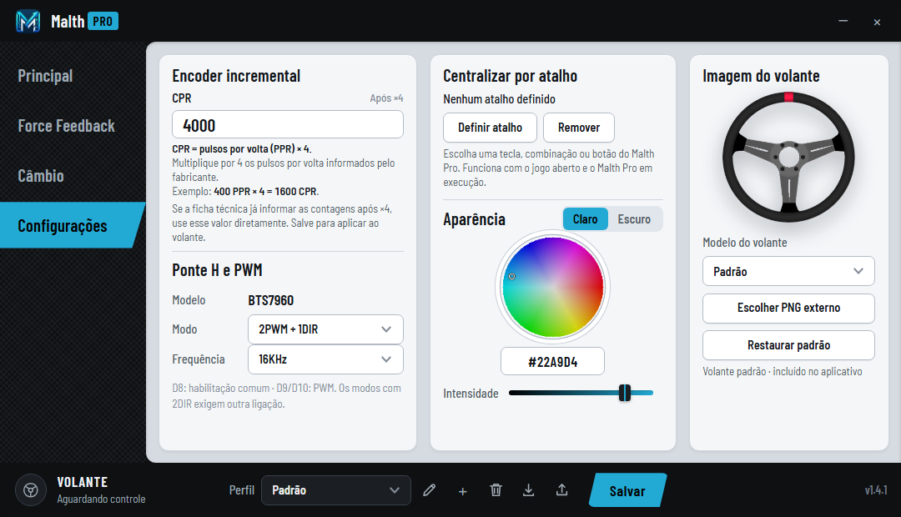
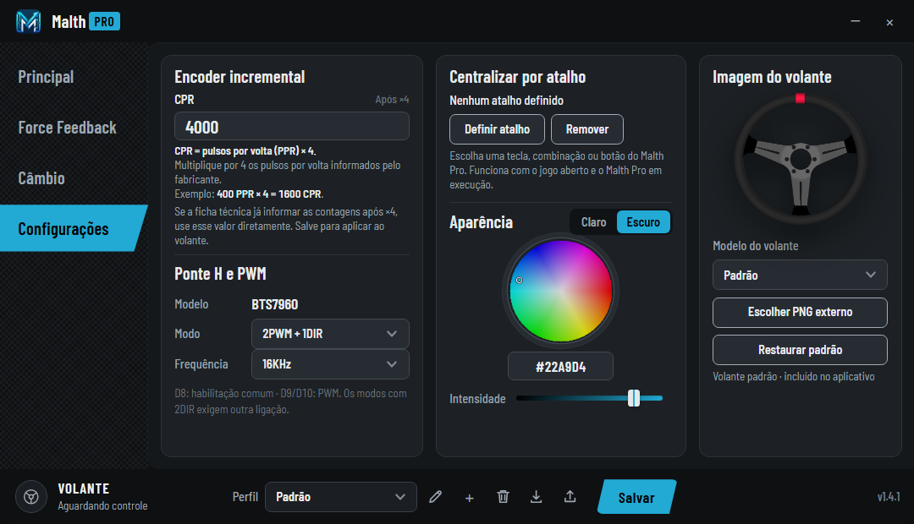

# Malth Pro

Aplicativo para Windows e firmware para Arduino Leonardo, desenvolvidos para
configurar um volante com Force Feedback, pedais e câmbio.

**Aplicativo Windows 1.4.1 · Firmware 0.2.0.** Escolha o tema em
**Configurações → Aparência**. O jogo controla o Force Feedback diretamente,
mesmo com o aplicativo fechado. A placa carrega o perfil salvo ao iniciar.

| Tema claro | Tema escuro |
| --- | --- |
|  |  |

[Notas da versão 1.4.1](docs/UPDATE_1.4.1.md) ·
[Roteiro de bancada do firmware 0.2.0](docs/UPDATE_1.4.0.md) ·
[Histórico do projeto](docs/HISTORICO_COMPLETO.md)

## Recursos

- Leitura do volante pelo encoder e ajuste de ângulo de 30° a 1080°.
- Calibração de mínimo e máximo dos quatro pedais.
- Linearidade do freio em dez pontos.
- Câmbio H-Shifter ou sequencial, com visualização ao vivo.
- Matriz de 16 botões pelo seletor do câmbio, com indicação dos pressionamentos.
- Configuração dos efeitos de Force Feedback e mola para jogos sem FFB.
- Perfis de configuração e gravação dos ajustes no Arduino.

## Hardware utilizado

- **Arduino Leonardo:** ATmega32U4, 16 MHz / 5 V.
- **Ponte H BTS7960**, com um motor DC.
- Encoder incremental, pedais analógicos e potenciômetros X/Y para o câmbio.
- Matriz de botões 4×4 prevista no firmware, com uso opcional.

### Pinagem principal

| Componente | Pinos do Leonardo |
| --- | --- |
| Encoder A / B | D0 / D1 |
| Acelerador / freio | A0 / A1 |
| Embreagem / freio de mão | A2 / A3 |
| Câmbio X / Y | A4 / A5 |
| BTS7960 R_EN + L_EN, juntos | D8 |
| BTS7960 LPWM / RPWM | D9 / D10 |

O encoder usa apenas A/B; a opção Índice Z foi retirada da interface.
O modelo BTS7960 fica fixo. O seletor permite **2 PWM + 1 DIR** (padrão) e
**1 PWM + 1 DIR**, adaptado aos mesmos fios. D8 continua sendo a habilitação
comum nos dois modos. Os modos com 2 DIR exigem outra ligação e ficam indisponíveis.
Veja [os modos e o roteiro de teste PWM](docs/PWM_BTS7960.md).

## Instalar o aplicativo

1. Feche uma versão anterior do Malth Pro, se estiver aberta.
2. Execute o instalador do Windows e siga as etapas da instalação.
3. Abra **Malth Pro** pelo atalho criado.

O instalador Windows x64 da versão 1.4.1 está sem assinatura digital.
O SHA-256 consta nas [notas da versão](docs/UPDATE_1.4.1.md).
Instruções para gerar o instalador: [desktop/README.md](desktop/README.md).

## Renomear e excluir perfis

No rodapé, selecione o perfil e clique no **lápis** ao lado do nome. Digite o
novo nome e clique em **Salvar nome**. O nome fica salvo neste computador;
renomear não altera os ajustes do volante. Para remover um perfil criado,
selecione-o e clique no **ícone de lixeira**.

## Gravar o `.hex` no Arduino

O aplicativo é instalado no Windows. O arquivo `.hex` contém o firmware que
deve ser gravado no **Arduino Leonardo**.

**Faça a gravação com a alimentação de potência do motor desligada**, mantendo
somente o USB conectado. Feche o Malth Pro e qualquer Monitor Serial antes de começar.

### 1. Preparar as ferramentas e gerar o firmware

Abra o PowerShell na pasta principal do projeto e execute:

```powershell
.\firmware\build-firmware.ps1
```

Na primeira execução, o script precisa de internet para baixar o Arduino CLI e
as ferramentas de compilação. O arquivo gerado será:

```text
firmware/releases/Malth Pro-v0.2.0.hex
```

### 2. Identificar a porta do Leonardo

No **Gerenciador de Dispositivos do Windows → Portas (COM e LPT)**, confira a
porta do Arduino, por exemplo `COM5`.

### 3. Enviar o firmware

Substitua `COM5` pela porta identificada:

```powershell
.\firmware\upload-leonardo.ps1 -Port COM5
```

O script solicita a entrada no bootloader Caterina e faz a gravação pelo USB.
A porta pode mudar temporariamente durante esse processo.

Se utilizar outro gravador, selecione **Arduino Leonardo** e o arquivo
`Malth Pro-v0.2.0.hex`. **Não use o arquivo `with_bootloader` para gravação USB.**

Se a gravação falhar, confira a porta COM e se algum programa ainda está usando
o Arduino. Mais detalhes: [firmware/README.md](firmware/README.md).

## Configurar o Malth Pro

### Conexão e volante

1. Deixe o volante reto antes de ligar o Arduino: a placa define o centro inicial.
2. Conecte o Arduino e abra o Malth Pro. Com o firmware 0.2.0, o FFB funciona
   sem o aplicativo e usa o perfil gravado na placa. Abrir ou reconectar o app
   preserva esse perfil e o centro. Salvar ou selecionar explicitamente outro
   perfil aplica os ajustes; Salvar também grava na EEPROM.
3. Na aba **Configurações**, ajuste o **CPR** conforme o encoder. O valor considera
   a leitura ×4: um encoder de 1.000 pulsos por volta utiliza CPR 4.000.
4. Mantenha a BTS7960 em **2 PWM + 1 DIR**. A frequência padrão é **16 kHz**.
5. Ajuste o ângulo desejado na tela **Principal** e clique em **Salvar**.

Use **Centralizar** quando precisar corrigir o centro: deixe o volante reto e
clique no botão. A referência é redefinida e o FFB é retomado.

### Aparência e imagem do volante

Na aba **Configurações**, escolha a cor na roda e ajuste a **Intensidade**.
A escolha é salva automaticamente neste computador. Em **Imagem do volante**,
use **Escolher PNG** (até 2 MB) ou **Restaurar padrão**. A imagem continua
acompanhando o encoder. Essas opções não enviam comandos ao Arduino.

### Pedais

Sensores Hall lineares 49E com saída analógica podem substituir os potenciômetros.
Use alimentação de 5 V, GND comum e saída analógica nos canais A0/A1/A2/A3
(acelerador/freio/embreagem/freio de mão). Confirme a pinagem do seu fabricante;
não alimente o sensor em 12 V. Calibre o curso útil pelo Mínimo/Máximo.
A distância e orientação do ímã devem evitar saturação e inversão ao longo do curso.
Referência: [Honeywell SS49E](https://automation.honeywell.com/us/en/products/sensing-solutions/sensors/magnetic-sensors/ss39et-ss49e-ss59et-linear-hall-effect-sensor-ic).

Para cada pedal:

1. Posicione-o no ponto que deseja considerar como início e clique em **Mínimo**.
2. Posicione-o no ponto que deseja considerar como fim e clique em **Máximo**.
3. Confira a barra de leitura e clique em **Salvar**.

O máximo pode ser definido antes do fim do curso físico. Embreagem e freio de
mão precisam estar habilitados para uso. Em **Linearidade do freio**, ajuste
os dez pontos da curva conforme a resposta desejada.

### Câmbio

- **H-Shifter:** ajuste os limites X/Y. Clique em **Calibrar**, engate cada marcha
  e clique no botão correspondente em **Registrar marcha** para registrar a posição. Os ajustes
  X/Y separam as regiões das marchas e a faixa de neutro.
- **Sequencial:** ajuste os limites do eixo Y para os movimentos de avanço e recuo.

Clique em **Salvar** para gravar os ajustes no Arduino. No jogo, associe os
eixos e botões às funções de volante, pedais e marchas.

### Force Feedback

Com o firmware 0.2.0, o FFB funciona com o aplicativo aberto ou fechado. O jogo
liga e desliga os atuadores pelo USB PID; batentes e Efeito fora do jogo funcionam
mesmo sem jogo nem aplicativo. Sem o aplicativo, vale o perfil **gravado** no
Arduino: use **Salvar** depois de ajustar.

| Situação | Configuração |
| --- | --- |
| Jogo com FFB | Habilite o FFB no jogo e deixe **Efeito fora do jogo → Desligado**. |
| Jogo sem FFB | Selecione **Efeito fora do jogo → Mola**, ajuste a intensidade e salve. |

Comece com intensidade baixa. Ajuste a força na aba Force Feedback e clique em
**Salvar**. Se o jogo travar e parar de mandar comandos, as forças ativas
(constante, periódicas, rampa) somem entre 1,5 e 2 s; perda de USB desliga o motor. Mantenha acesso ao corte da alimentação de potência nos testes.

## Estado do projeto

**Em desenvolvimento e validação de bancada.** A conexão e as leituras de
pedais/câmbio já foram confirmadas no hardware. A resposta do motor, o sentido
da força, a latência e a compatibilidade com jogos ainda precisam ser validados.

A saída do motor segue **Força mínima** e **Força máxima** do perfil, de 0% a
100%, sem teto fixo de bancada. Os presets não alteram esses dois controles.
Se a mola empurrar no sentido do movimento em vez de se opor a ele, interrompa
o teste e confira o sentido do conjunto motor/encoder antes de continuar.

## Organização dos arquivos

```text
desktop/       Aplicativo Windows e geração do instalador
malth-control/ Arquivos da interface usada pelo aplicativo
firmware/      Código do Leonardo, bibliotecas, scripts e arquivos .hex
docs/          Documentação e imagens
```

As bibliotecas utilizadas mantêm seus avisos e licenças nos respectivos diretórios.

Pedais opcionais e atalho de centralização: [notas1.3.4](docs/UPDATE_1.3.4.md).

Configurações e investigação de giro/desconexão: [notas1.3.5](docs/UPDATE_1.3.5.md).

Temporização dos efeitos rápidos e auditoria de cada opção: [notas1.3.6](docs/UPDATE_1.3.6.md).


Configurações sem rolagem e atalho no painel central: [notas1.3.7](docs/UPDATE_1.3.7.md).


Calibração visível do câmbio e prévia sequencial com ré: [notas1.3.8](docs/UPDATE_1.3.8.md).
