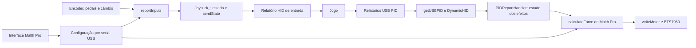

# Malth Pro — rastreamento de HID, FFB e configurações

Data: 20/10/2026.

Método: consultas ao mapa existente do Graphify, seguidas de leitura dos arquivos citados. Nenhum teste de execução, jogo ou bancada foi realizado. As ligações abaixo confirmadas pela leitura do código complementam as relações incompletas do mapa; o grafo original não foi reconstruído nesta consulta.

## 1. Como Joystick_ conecta entradas, relatórios e FFB

Há três caminhos distintos:



### Entradas para o jogo

`reportInputs()` lê A0–A5, aplica calibração e linearidade, normaliza a direção e atualiza o objeto `wheel`, instância de `Joystick_`.

| Entrada | Campo HID usado atualmente |
| --- | --- |
| Direção do encoder | X |
| Acelerador | Y |
| Freio | Z |
| Embreagem | Rx |
| Freio de mão | Ry |
| Câmbio X | Rz |
| Câmbio Y | Rudder |
| Marchas e matriz | Botões |

Um pedal desabilitado recebe zero no relatório HID. Os seis ADCs continuam sendo lidos e enviados como valores brutos pela telemetria serial, o que é diferente de ativar um pedal no jogo.

O firmware usa `wheel.begin(false)`: agrupa as mudanças e chama `wheel.sendState()` uma vez por ciclo. A biblioteca empacota os campos e chama `DynamicHID().SendReport()`. O envio verifica espaço no endpoint antes de transmitir; o comentário documenta a intenção de evitar espera longa quando o host deixa de ler.

Fontes: `firmware/Leonardo/MalthProLeonardo/Controller.cpp:222`, `:398`; `firmware/libraries/JoystickFFB/src/Joystick.cpp:938`; `firmware/libraries/JoystickFFB/src/DynamicHID/DynamicHID.cpp:102`.

### Efeitos vindos do jogo

O Timer3 solicita `wheel.getUSBPID()`. Essa função chama `DynamicHID().RecvfromUsb()`, que entrega o pacote ao `PIDReportHandler.UppackUsbData()`. O handler interpreta criação, parâmetros, início e parada dos efeitos e mantém `g_EffectStates`. O transporte também tem caminhos de `SetReport` e `GetReport`, com os tipos e IDs explicitamente tratados no código; isso não comprova implementação universal de todo relatório HID possível.

O cálculo usado pelo Malth Pro é `Controller.cpp::calculateForce()`. Ele lê os efeitos ativos, posição e movimento do encoder, aplica ganhos, filtros, efeitos locais e batentes. `writeMotor()` converte o resultado em PWM para a BTS7960, respeitando habilitação, centralização e limite de bancada de 25%.

**A função `Joystick_::getForce()` existe na biblioteca, mas não é chamada pelo controlador do Malth Pro.** O motor usa o cálculo próprio. Portanto, a centralidade de `Joystick_` no mapa não significa que todos os métodos de cálculo dessa biblioteca participem do firmware atual.

Fontes: `Controller.cpp:60`, `:92`, `:128`, `:410`; `Joystick.cpp:490`, `:495`; `DynamicHID.cpp:124`, `:134`, `:167`; `firmware/libraries/JoystickFFB/src/DynamicHID/PIDReportHandler.cpp:239`.

O período nominal do controle é 2 ms; o receptor PID é solicitado nominalmente a cada 1 ms. São tempos programados, não medições da latência total do Windows, USB, jogo ou motor. A interface recebe telemetria nominalmente a cada 32 ms. Ela não precisa retransmitir cada efeito do jogo: esse tráfego segue pelo HID do Leonardo. O aplicativo mantém a sessão serial e o heartbeat de habilitação.

## 2. Como Register conecta configuração e firmware

`Register` é um enum de índices de software, não um conjunto de registradores físicos do ATmega32U4. `Config` contém um vetor de 65 valores `int16_t` nessa ordem. A ordem deve coincidir com a codificação do aplicativo.

```text
Perfil da interface
  → encodeProfile(): valida e produz 65 valores ordenados
  → profileFrames(): BEGIN, SET em blocos, COMMIT
  → DeviceLink: envia e aguarda confirmação de cada comando
  → firmware: recebe em staging.value[]
  → validConfig(): valida o perfil completo
  → COMMIT: troca a configuração ativa
  → SAVE, quando solicitado: persiste na EEPROM
  → MotorSession: centralização inicial e ARM conforme o estado da sessão
```

`BEGIN` desabilita a força e abre uma transação. `SET` só aceita a próxima posição esperada. `COMMIT` exige todos os 65 valores e uma configuração válida, aplica PWM e reinicia estados de movimento/câmbio. `SAVE` é separado: grava em dois slots alternados, com versão, geração, CRC e marcador de conclusão. Na partida, o firmware procura a configuração válida mais recente; caso não encontre, usa os padrões.

Fontes: `firmware/Leonardo/MalthProLeonardo/Config.h:7`, `:23`, `:46`; `desktop/device-protocol.cjs:11`, `:72`; `desktop/device-link.cjs:73`; `Controller.cpp:264`, `:280`, `:298`; `desktop/motor-session.cjs:34`.

## 3. Ligações ausentes de CPR, ANGLE e INVERT

A consulta ao grafo encontrou apenas a relação de cada nome com o enum `Register`. A leitura do código confirmou os usos abaixo. Portanto, a lacuna principal está na extração de acessos indexados e na correspondência entre JavaScript e C++.

| Registro | Origem na interface/protocolo | Uso real no firmware |
| --- | --- | --- |
| CPR, índice 0 | `cprCfg` → `encodeProfile()` | Contagens decodificadas por volta; escala da direção, amortecimento, inércia, efeito local e hardlock |
| ANGLE, índice 1 | `steeringAngleCfg` → `encodeProfile()` | Define o curso total e os limites de direção junto com CPR |
| INVERT, índice 2 | `invertSteeringCfg` → 0/1 | Inverte posição lida e ajusta o sinal enviado ao motor |

Validações: CPR de 4 a 32000; ANGLE de 30° a 2160°; INVERT 0 ou 1. Os valores padrão são 4000, 540° e 0. O contador do encoder é atualizado pelas transições dos canais A/B; CPR precisa corresponder a essa contagem decodificada.

A escala usada é:

```text
meioCursoEmContagens = CPR × ANGLE / 720
```

Exemplo com os padrões: 4000 × 540 / 720 = 3000 contagens para cada lado do centro, equivalentes a ±270°. O valor é normalizado para o eixo HID X entre -32767 e 32767.

### Relações que precisam constar em um mapa mais completo

- `cprCfg` → `encodeProfile` → índice CPR → `Config.value[CPR]`.
- `steeringAngleCfg` → `encodeProfile` → índice ANGLE → `Config.value[ANGLE]`.
- `invertSteeringCfg` → `encodeProfile` → índice INVERT → `Config.value[INVERT]`.
- CPR e ANGLE → cálculo de meio curso em `malthLoop()` → `reportInputs()` e `calculateForce()`.
- CPR → métricas e batentes em `calculateForce()`.
- INVERT → `readPosition()` e `writeMotor()`.
- CPR e INVERT → invalidação da centralização no `COMMIT`.
- `Config` → `validConfig()`, configuração ativa, CRC e persistência na EEPROM.

Fontes: `desktop/device-protocol.cjs:19`; `Config.h:25`, `:46`; `Controller.cpp:74`, `:103`, `:155`, `:198`, `:332`, `:420`.

## Dois problemas identificados pela leitura

**Atualizacao:** os problemas abaixo descrevem a versao 1.2.3 analisada.
Foram corrigidos no aplicativo 1.2.4. O roteiro de verificacao esta em
`docs/UPDATE_1.2.4.md`; a reproducao e a validacao em bancada seguem pendentes.

### 1. Inversão aplicada novamente na imagem

O firmware já inverte a direção em `readPosition()`, e a telemetria `steering` deriva dessa posição. A interface divide esse valor por 32767 e, em `renderSteeringWheel()`, multiplica novamente pelo sinal de `invertSteeringCfg`. Com inversão habilitada, os dois sinais se cancelam na imagem, embora o eixo HID permaneça invertido.

Correção indicada: distinguir um eixo já transformado pelo firmware de um eixo bruto usado pela prévia; aplicar a inversão exatamente uma vez. A telemetria nativa atual não deve receber a segunda inversão.

Fontes: `Controller.cpp:74`, `:224`, `:375`; `malth-control/app.js:405`, `:419`, `:449`.

### 2. Centralização desatualizada na sessão após alterar CPR ou INVERT

O `COMMIT` do firmware marca `centered = false` quando CPR ou INVERT mudam. `MotorSession.sendProfile()` mantém seu próprio `centered = true` após a primeira centralização. Nessa situação, pode pular `CENTER`, enviar `ARM` e receber `COMMAND_OR_CENTER_REQUIRED`, deixando a força interrompida até centralizar novamente.

Correção indicada: sincronizar a necessidade de centralização após aplicar o perfil; preservar a política de retomada e o bloqueio por Esc. O código possui mensagens de telemetria com o estado `centered`, mas a sessão de envio não as usa para atualizar esse estado local.

Fontes: `Controller.cpp:332`, `:347`; `desktop/motor-session.cjs:10`, `:34`; `malth-control/app.js:618`.

Esses dois comportamentos foram identificados por leitura estatica e deram
origem as correcoes do aplicativo 1.2.4. O firmware e o HEX 0.1.0 foram preservados.
A validacao do comportamento corrigido em bancada segue pendente.
